<div align="center">
  
  <h1>Jaude</h1>
  <p><strong>Your Claude subscription limits, at a glance in the menu bar.</strong></p>
</div>

Jaude puts one small gauge in the macOS menu bar. No numbers, no noise: it starts full and drains as you use Claude, so you know where you stand without opening anything.

Click it for the details:

- every limit Claude reports: the current session, the week, and per-model weekly limits such as Fable;
- what is left of each one and when it resets;
- usage credits, when they are enabled on your plan.

Each bar is blue while you are on track, orange when your pace would run it out before it resets, and red when it is nearly gone or burning far too fast.

## Settings

From the slider button in the panel:

- **Menu bar icon**: bars, level, battery or ring;
- **Refresh every** 2, 5 or 15 minutes;
- **Open at Login**.

## Install

Requires macOS 26 or later, on a Mac where Claude Code is signed in with a Pro, Max, Team or Enterprise plan.

Download `Jaude-<version>.dmg` (or `Jaude.zip`) from the [latest release](https://github.com/thibautgnt/Jaude/releases/latest) and drag `Jaude.app` to Applications. It is signed with a Developer ID and notarized by Apple, so it opens without any warning.

## How it works

Jaude reads the sign-in token Claude Code keeps in your login keychain and asks Claude's usage endpoint, the one behind `/usage` in Claude Code, for your limits. That request is the only thing that leaves your Mac.

It is built to go unnoticed:

- one request per refresh interval, none while the screen sleeps;
- opening the panel only refreshes when the data is more than 2 minutes old;
- the token stays in memory; the keychain is read again only when the server refuses it;
- Jaude never refreshes the token itself. If it has expired, opening Claude Code renews it.

The usage endpoint is undocumented and may change without notice.

## Build

Needs the Xcode Command Line Tools only.

```sh
make install   # build, sign ad hoc, copy to ~/Applications and launch
make check     # parsing and pace checks against a recorded response
make icon      # regenerate the app icon from Icon/render.swift
make release   # Developer ID signed, notarized zip and dmg in dist/
make publish   # make release, then publish dist/ as a GitHub release
```

## License

MIT
